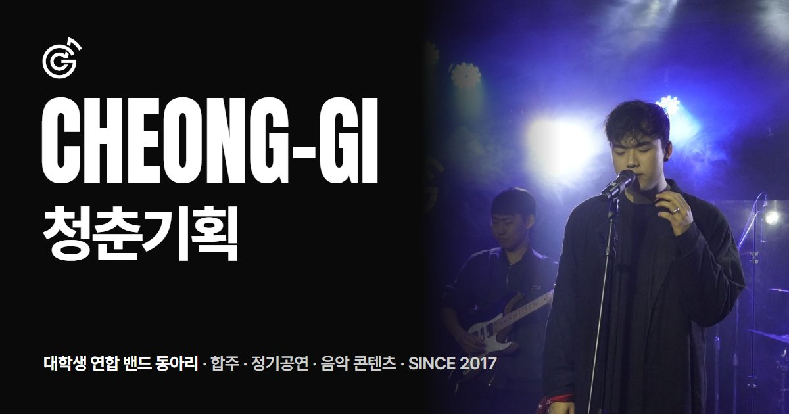

<div align="center">



# 청춘기획 CHEONG-GI

**대학생 연합 밴드 동아리 청춘기획의 공식 웹사이트**

[**cheonggi.vercel.app**](https://cheonggi.vercel.app) &nbsp;·&nbsp;
[Instagram](https://www.instagram.com/play_cheonggi/) &nbsp;·&nbsp;
[YouTube](https://www.youtube.com/@cheong-gi3039) &nbsp;·&nbsp;
[지원하기](https://linktr.ee/Chunggi)

</div>

<br>

## 화면 구성

한 화면씩 넘겨 보는 구조입니다. 상단 메뉴를 누르면 화면이 바뀌고, 주소 끝에 `#about`처럼 붙이면 그 화면이 바로 열립니다.

| 화면 | 내용 |
|---|---|
| **HOME** | 유튜브 영상 썸네일이 흐르는 첫 화면 |
| **ABOUT** | 동아리 소개, 주요 숫자, WHAT WE DO |
| **SHOWS** | 역대 정기공연 포스터 · 누르면 셋리스트와 공연 정보 |
| **ACTIVITY** | 활동 카테고리 · 누르면 사진이 펼쳐지는 갤러리 |
| **FAQ** | 지원 전에 자주 묻는 질문 |
| **JOIN US** | 합주 시간, 회비, 다음 공연, 지원 링크 |

<br>

## 시작하기

빌드 도구 없이 HTML · CSS · JavaScript만으로 만들었습니다.

```bash
git clone https://github.com/rlaalswo1222/Cheong_gi.git
```

`index.html`을 브라우저로 열면 바로 볼 수 있습니다.

<br>

## 폴더 구조

```
index.html             화면 구조와 고정 문구 (ABOUT · FAQ · JOIN US)
styles.css             디자인 · 애니메이션 · 모바일 대응
script.js              데이터와 동작 (공연 목록 · 활동 갤러리 · 홈 썸네일)
assets/img/            사진 (같은 이름의 .webp 와 .jpg)
update-thumbnails.py   홈 화면 유튜브 썸네일 갱신
deploy-vercel.py       Vercel 배포
```

<br>

## 자주 고치는 곳

학기가 바뀌면 아래 내용을 확인해 주세요.

| 바꿀 내용 | 파일 | 찾을 곳 |
|---|---|---|
| 합주 시간 · 회비 · 다음 공연 · 지원 링크 | `index.html` | `join__list` |
| ABOUT 숫자 (현재 부원 수 등) | `index.html` | `ab-stats` |
| FAQ 질문과 답 | `index.html` | `faq__item` |
| 정기공연 추가 | `script.js` | `const PROJECTS` 맨 위에 한 줄 |
| 활동 카테고리 · 갤러리 사진 | `script.js` | `const NOTES`, `const GAL` |

<details>
<summary><b>정기공연 추가 예시</b></summary>

<br>

포스터를 `assets/img/work-17.jpg`로 넣고, `PROJECTS` 맨 위에 추가합니다.
여름 공연은 그해 1학기(`26-1`), 겨울 공연(12~2월)은 앞 해 2학기(`26-2`)로 적습니다.

```js
{ term: '26-2', title: '공연 이름', file: 'work-17.jpg', date: '2027.02.00 SUN',
  time: '18:00', venue: '공연장', songs: '20곡', setlist: ['sl-08.jpg'] },
```

</details>

<br>

## 사진 넣기

사이트는 용량이 작은 **WebP**를 먼저 불러오고, 열지 못하는 브라우저에서만 **JPG**를 씁니다.
그래서 사진은 **같은 이름으로 두 형식을 함께** 넣어 주세요. 코드에는 `.jpg` 이름만 적으면 됩니다.

```bash
pip install pillow
python -c "from PIL import Image; Image.open('assets/img/work-17.jpg').save('assets/img/work-17.webp', quality=80)"
```

- 긴 쪽 **1400px 안팎**이면 충분합니다. 원본(4000px 이상)을 그대로 넣으면 사이트가 무거워집니다.
- 갤러리 사진은 크게 보기용 `gal-이름-01`과 목록용 작은 사진 `gal-이름-01-t` 두 장이 필요합니다.

<br>

## 홈 썸네일 갱신

유튜브 채널의 최신 영상 썸네일로 홈 화면을 다시 채웁니다.

```bash
python update-thumbnails.py       # 최근 30개
python update-thumbnails.py 12    # 최근 12개만
```

<br>

## 배포

[Vercel](https://vercel.com)에 올라가 있습니다. 바뀐 파일만 올라가므로 보통 1분 안에 끝납니다.

```bash
python deploy-vercel.py <토큰 파일 경로>
```

> [!IMPORTANT]
> 토큰 파일은 **프로젝트 폴더 밖**에 두세요. 토큰은 [vercel.com/account/tokens](https://vercel.com/account/tokens)에서 만들 수 있습니다.

<br>

---

<div align="center">

Site by **김민재** · © 2026 청춘기획 CHEONG-GI

</div>
